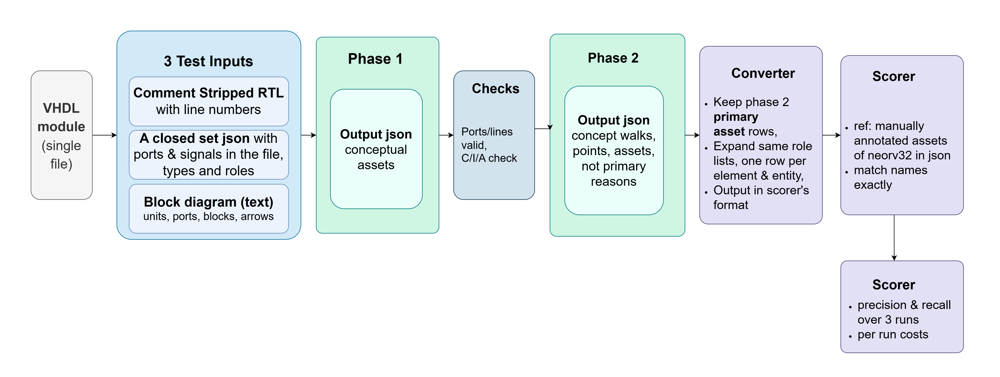
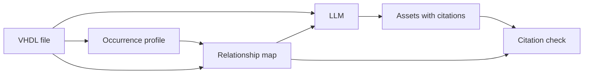
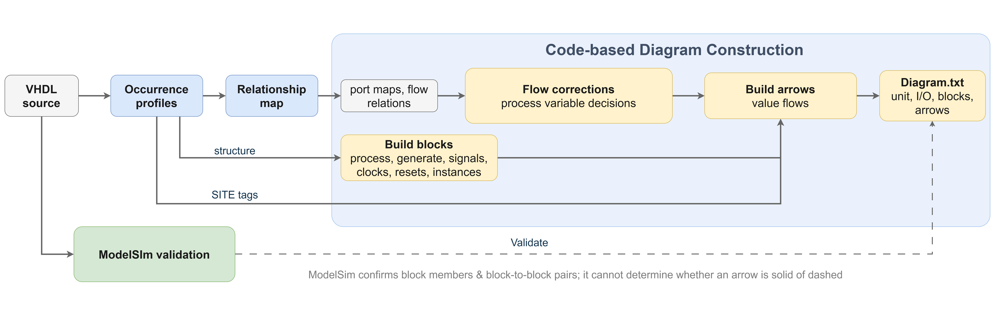

# LLM-Assisted Security Asset Identification from RTL

Exploring how RTL element relationships, structure, information-flow diagrams and different prompting techniques influence an LLM's identification of security-relevant assets from RTL.

This repository explores the research question, "*Can an LLM locate the security-relevant assets of an IP from the RTL file and inputs derived from it by code, with no specification document?*" by studying the **`Asset Generation` phase of the LAsset framework** (arXiv:2601.02624, DATE 2026).

During replication, these prompting effects were explored:

* whether RTL-derived structural information can improve identification
* whether separating the asset identification problem into two tasks, first identifying the conceptual assets and then finding the structural assets under them, can improve identification
* whether P3164's Conceptual and Structural Analysis (CSA) and Points of Influence and Observation (PIO) provide useful reasoning frameworks
* whether the structure of the prompt, and where a rule appears in it, affects a model's performance and its inclination to follow the rule

### The framework I arrived at



## Key Findings
On all 41 modules (300 reference entries, 296 findable under the exact scorer, primary assets only). Precision and recall are the mean of the three per-run values; sd is across the three runs. The pooled ratios in Table 4 agree to three decimals.

| Method | Precision (sd) | Recall (sd) | runs |
|---|---|---|---|
| LAsset, RTL-only initial list (published) | 0.704 | 0.757  | one list |
| Two-phase prompt (working version) | 0.708 (0.037) | 0.845 (0.018)  | 3 |

Caveat: the held-out 26 modules later helped tune the working prompt from v9j onwards. This then stops being a blind test.

The final two-phase approach achieved **0.708 precision / 0.845 recall** over all 41 modules, compared with **0.704 / 0.757** for LAsset's RTL-only initial list under the same exact scorer.
More importantly, the experiments showed that better RTL grounding does not automatically solve asset identification: the remaining false positives often have the same RTL behaviour as reference assets.

## Related works & their contribution

### How the literature was used

LAsset shaped the pipeline; P3164 gave the prompt its frame.
Every prompt rule needed a basis: a published source, the prompt's own definitions (which trace to the six sources below), or a logged user decision where the rule follows the reference's convention.
Rules drawn from a failure analysis went through the same check before they entered the prompt.


- **LAsset** (Hasan et al., DATE 2026): the task, Algorithm 1 lines 3–5, the manual list as the reference and the published lists as the comparison rows. Not replicated: secondary assets, the refinement stage, Degree of Influence.
- **IEEE P3164 white paper** (2024): the conceptual vs structural split, the four CSA questions for Phase 1, the PIO questions for Phase 2. Kept out: "ports are attack surface, not assets"; memory arrays as assets stay a reference convention.
- **Accellera SA-EDI** (2021): the asset types, and the basis for treating state, setting and decision elements as primary. Kept out: its Secret / Sensitive / Critical labels (judgements, so banned in prompts); lock bits as primary.
- **SAIF** (Farzana et al., VTS 2021): the primary/secondary split; carriers, transit registers and bus ports as secondary. Rejected: its demotion step as a prompt arm (recall 0.925 → 0.628); its FSM-state convention, which conflicts with the reference.
- **Nath & Tan** (ISQED 2025): reading a signal's role from where it appears in the code; the four behavioural patterns. Rejected: the August parser readings taken from them, which made results worse.
- **Hu, Ardeshiricham & Kastner** (ACM CSUR 2021): explicit vs implicit flow, for the diagram's arrows. Not used: the tracking machinery itself.
- **CWE** (MITRE): CWE-1206 as the clock and reset exception; four CWEs that showed "transaction ports are never assets" was too absolute. Not built: LAsset's CWE-gated refinement.

What each source gave to each prompt version, and what was tried and dropped, is in the ablation logs (table under Metrics).


## Overview
### Reproducing LAsset's Asset Generation stage

The replication's prompt followed LAsset: Retrieval Augmented Generation (a datasheet summary from LAsset's SpecRAG), prompt chaining (the parsers, then asset generation) and few-shot prompting (two worked examples).

*Problem:* The paper's description of modular RTL parsing is ambiguous. It does not specify how the two LLM-based parsers separate the elements. Section III-A says, *"implement two LLM-based parsers: one for I/O ports and another for internal signals/registers,"* but in the algorithm's line 4, `MOD RTLPARSE {Prmm, Secm}` indicates that the parser separates the primary and secondary asset candidates, which should be assetgen's decision, which is a later stage.

I designed the parsing stage like this:

* A regex extractor, `rtl_parse.py`, reads each entity's port list and each architecture's signal declarations. This creates a `closed set`; the prompt specifies that every asset the model names must be from this list. The elements were extracted by code and not by the LLM, to avoid hallucinations.
* The LLM is only used to annotate. Two prompts, one for ports and one for signals, receive the RTL plus the list and must return exactly those names with a short function each.
* Record-typed ports and signals were expanded into their fields using a registry built from the package file, so a bus-request port became the port plus 12 fields.

*Limitations:* Arm P-2 on 8 August removed the parsed blocks and let the model read the declarations itself: recall moved by -0.020 (interval includes zero), precision +0.017. The model produced 187 names outside the list and invented none; all were real identifiers the regex had ignored, nearly all in the package file, which has no entity. (Log: `logs/RECALL_ABLATION_LOG.md`, arm P-2; re-scored in `experiments/01_prompt_baselines/notebooks/recall_ablation_log.ipynb`.)

*Decision:* Instead of only *"types and functions at the module level"* in the parsed json, I decided to include `roles` and `relationships` of the elements in relation to other elements in the closed set. (The arms that tested this, RP and C1, are in `logs/PRECISION_ABLATION_LOG.md`; re-scored in `experiments/01_prompt_baselines/notebooks/precision_ablation_log.ipynb`.)

**Final working prompt of this study:** the `v2` baseline, `ASSET_V2_BASE` in `src/prompts_v2.py`, with the two worked examples from `src/icl_examples_*.py`. No precision arm beat it, so it stayed the baseline. The recall round's last promoted version, `v01c6p1p2`, is in `src/prompts.py`.

*Problem:* How to derive relationships between elements in an entity?

**The question.** Can certain patterns in where an element appears in the code, and how it relates to other elements, help identify potential assets, as a complement to the CSA questions?

Nath & Tan (ISQED 2025, arXiv:2502.04648) find primary assets in Verilog from behavioural patterns. A signal's role can be read from where it appears: in a condition, on which side of an assignment, through an instantiation. From that idea I built two structures per module:

- **Occurrence profile:** one entry for every place a signal's name appears. What each field holds (the entries are in
  `map_pipeline/occurrence_profiles/<module>.json`):

  ```json
  {
    "Occurrence ID": "the number of this appearance counted per signal from 1, in file order",
    "Occurrence Lines": "its line in the source file",
    "Name As Written": "the name as written on that line, with any index or slice (for example `ctrl.lock`); on a record field's first entry it names the record's declaration, as in `ctrl (declaration of the base)`",
    "Line Text": "the line, with comments removed",
    "Context": "the VHDL blocks around the occurrence, innermost first, each with its line range",
    "Path": "the conditions that must hold for this line to run, outermost first, for example `rising_edge(clk_i)`. Empty for a declaration, which is not inside any `if` or `case`.",
    "SITE Tagged": ["`DECL_PORT` (declared as a port), `LHS_PROC` (assigned inside a process), `IF_COND` (read in an `if` condition), `EDGE_CHECK` (the clock in `rising_edge(...)`), `RHS_OPERAND` (read as an operand). There are 21 tags; their rules are in `bahavioral_patterns_of_assets/annotation_pack_elements/occurrence_prompts_v3d/rulebook.json`"]
  }
  ```

- **Relationship map:** The relationship map uses seven pairs of relationship tags, one on each side of an assignment:  

  * two value tags (CARRIES/COPIES for an exact copy, SOURCES/DERIVES_FROM for any other read)  
  * five control tags (SEQUENCES/CLOCKED_BY for the clock, RESETS/RESET_BY, SELECTS/SELECTED_BY for a case selector or index, CONSTRAINS/CONSTRAINED_BY for a comparison between elements, GATES/GATED_BY for an enable or condition).

  Wiring through an instance port is recorded separately, as a connection to the sub-unit's port. Each record cites the occurrence IDs where it holds, and code adds per-element facts such as storage, port boundary, record-field handling, constant drivers and configuration.



*Failure:* The relations did not answer the CSA questions, which ask whether a value could be changed, observed or blocked. For an RTL element the map always supplies a writer, a reader and often an output path, so the honest answer is "yes" nearly every time.

What decides membership is not in the map. Hits and false positives have the same relationship profiles: all 13 classes occur on both, 23.8% of false positives match a hit's profile exactly, and 97% of false-positive citations verify. 

What separates them is a convention about which point along a flow the reference names (the stored register, the boundary pin, the decision bit, not the carrier), applied unevenly across modules. (Log: `logs/MAP_ABLATION_LOG.md`; re-scored in `experiments/02_rtl_structural_analysis/notebooks/map_ablation_log.ipynb`.)

**Final working prompt of this study:** `assetgen_meta/prompt_opt/v1/exec_prompt.txt`, run on gpt-5.4 with the inputs in `assetgen_meta/traced_inputs_v2/` (RTL, map and flow graph per module). `FINAL_NOTEBOOK.ipynb` runs it end to end.

*Decision:* Separate conceptual asset finding and structural asset identification into two tasks. The PIO method is better suited to finding the points along the flow of information where the structural assets sit.

**The question.** Can a two-phase prompt be used to check both conceptual assets and structural assets? 

Each phase was checked on its own: Phase 1 for the conceptual assets it named, Phase 2 for the structural assets it listed.

**Prompt technique.** Prompt chaining: two calls per module. Phase 1 finds the conceptual assets with the CSA questions.
Phase 2 finds the structural assets of each concept with the points of influence and observation (PIO) method. 

The idea to split them into two calls came from the DVCon Europe 2024 talk
"A Detailed Tour of IEEE standard P3164" (Grammatikakis, presented by Bormann). Of the replication's three techniques, the
two-phase prompt keeps only the chaining. The datasheet summary went in August (arm P-1: removing it changed nothing),
the worked examples went with the two-phase design, and code-built inputs (the closed set and a block diagram) took
the place of the parsed lists. The prompt has definitions, a rubric and rules.

**How the diagram for PIO was built.** Code built
(`src/pio_diagram/`: `pio_graph.py`, `pio_blocks.py`, `pio_inputs.py`; `msim_check.py` validates the blocks with ModelSim):



1. the closed set: every port, signal and record field;
2. the module hierarchy: every instance and its child entity;
3. a flow graph: explicit flows (B is assigned from A) and implicit flows (A decides whether, or which, B is assigned),
   after Hu, Ardeshiricham and Kastner's information-flow survey (ACM CSUR 2021, section 2.4). Clocks and resets are
   kept apart; they are not flows;
4. blocks: the graph grouped into processes, generate blocks, concurrent assignments and instances. Arrows carry values
   (`==>`) or decisions (`-->`) and are labelled with the signals they carry.

The watchdog's diagram as the model sees it is `experiments/03_two_phase_csa_pio/lab/inputs/v1/tuning/neorv32_wdt/diagram.txt`, next to its `rtl.txt` and `closed_set.json`.

**Final working prompt of this study:** `experiments/03_two_phase_csa_pio/lab/prompts/two_phase_p1o_first/` (`common.md`, `phase1.md`, `phase2.md`; contents in Table 5), run on gpt-5.6-luna with the inputs in `experiments/03_two_phase_csa_pio/lab/inputs/v1/`.

## Debugging the two-phase prompt design

- Phase 1 alone: Phase 1-only runs, scored by the share of reference entries whose concept Phase 1 located.
- Phase 2 alone: Phase 2 re-run on stored Phase 1 replies, so the two phases' run-to-run variation is separated.
- One rule alone: a new rule tested on its target modules before it enters the full prompt.
- Blind boundary test: a new rule applied to stored replies, to check it removes no hit.
- Position tests with a sham block of the same length as the control.

*Limitations:* Three decisions were taken from the reference, not from theory. Each is labelled "user decision: reference convention" in its version's README. A change in the reference voids them. 

1. Clocks and resets are not conceptual assets (12 Oct). The reference lists none.
2. Prompt lines that only produced extra concepts, with no hit under them, were removed or restricted (12 Oct).
3. Exclusion rules for groups the reference never lists: stored-word memory arrays and processor control-unit state
   (18 Oct), and debug-module registers (19 Oct).

> From v9g on, the held-out 26 were also used to tune the phase 1 & 2 prompts to choose between versions. So the held-out numbers from there on are not a blind test anymore.


## Experimental Design
### Data

The asset generation pipeline was tested on NEORV32, a RISC-V processor written in VHDL. I used the 41 modules selected
by the input preprocessing stage of the LAsset framework. These are the modules for which LAsset published a manual
asset list. The RTL is LAsset's own copy of NEORV32, in `data/RTL_data/` and `data/RTL_heldout/`.

The 41 modules were split once:

- 15 tuning modules (111 reference entries). I developed the prompts on these.
- 26 held-out modules (189 reference entries). Kept aside for testing. In the third study they were also used to choose between prompt versions. 

From 14 October, the 12 held-out modules that caused v7's drop joined the tuning set as `tuning_v2` (27 modules); v10 to v12 had their gates read there.

### Ground Truth
The sheet "Assets (Manual)" in LAsset's repository
([Ajoad/LAsset-Security-Assets](https://github.com/Ajoad/LAsset-Security-Assets),
`SoC/Asset_Dataset_Statistics_NEORV32.xlsx`). LAsset's authors wrote it by hand and cross-checked it with LLM chatbots
(paper, p.5). It has 302 entries over the 41 modules. Two are repeats, so 300 are scored. It lists primary assets only.

### Metrics

**Precision and recall.** Only primary assets are scored. The reference lists no secondary assets. A listed element that is in the reference is a hit. One that is not is a false positive, including elements LAsset would call secondary.

`Precision = hits / model-emitted assets`

`Recall = hits / findable reference entries`

Under the exact scorer, 296 of the 300 reference entries are findable in the corresponding module's element list (109 of 111 tuning, 187 of 189 held-out). For three runs, this gives 888 findable entry-runs.

A false positive only means the reference does not list the element. It does not prove the element is not an asset.

**The exact scorer** in `experiments/03_two_phase_csa_pio/lab/analysis/two_phase_v8__gpt-5.6-luna__high__r0-r2/compare_v8.py`: names must be
equal, each reference entry counts once, and only findable entries count. In Tables 1 to 4 the three runs are pooled
(hits and listed elements summed over the runs); the Key Findings table gives the mean of the per-run values.

**Comparison rows.** LAsset's published initial lists, scored with the same scorers. The RTL-only list is the fair
comparison, since my pipelines read RTL only. The spec+RTL list is shown beside it.


Scripts: `experiments/03_two_phase_csa_pio/lab/analysis/score_lasset_exact.py`.

**Ablation method.** One change per version, paired against its own baseline. A pass rule was written before each run, three runs per version (five to promote in August), and the verdict was read from pooled counts and module-level sign tests, never from one run. The short-form logs, one per study, give one line per arm (what changed, the rule before the run, the result, the decision), and each has a notebook that re-scores every stored run:

| study | log | notebook |
|---|---|---|
| recall round, 2 to 8 Aug | `logs/RECALL_ABLATION_LOG.md` | `experiments/01_prompt_baselines/notebooks/recall_ablation_log.ipynb` |
| precision round, 8 to 18 Aug | `logs/PRECISION_ABLATION_LOG.md` | `experiments/01_prompt_baselines/notebooks/precision_ablation_log.ipynb` |
| relationship map, 20 Sep to 3 Oct | `logs/MAP_ABLATION_LOG.md` | `experiments/02_rtl_structural_analysis/notebooks/map_ablation_log.ipynb` |
| two-phase prompt, 10 to 19 Oct | `logs/TWO_PHASE_ABLATION_LOG.md` | `experiments/03_two_phase_csa_pio/two_phase_ablation_log.ipynb` |
| the whole prompt line, July to Oct | `logs/ABLATION_LOG_JUL_OCT.md` | the scripts named in the log |


## Results

**Why gpt-5.6-luna.** The first version ran once on three models. On the 15 tuning modules, luna came close to gpt-5.4
at a small fraction of the cost, so every later version ran on luna (one run each, exact scorer; cost from the stored
token counts at the list prices in `experiments/03_two_phase_csa_pio/lab/cost_estimate.py`):

| model | P / R | listed | cost of the run |
|---|---|---|---|
| gpt-5.4 | 0.187 / 0.771 | 449 | USD 27.35 |
| gpt-5.4-mini | 0.268 / 0.523 | 213 | USD 13.43 |
| gpt-5.6-luna | 0.183 / 0.807 | 480 | USD 0.77 |


<details>
<summary><b>Version-by-version results: Tables 1 to 3</b> (how each prompt change moved precision and recall; wording and length; rule order and position)</summary>

**Table 1. How P and R changed with each debug decision** (gpt-5.6-luna, exact scorer, 3 runs unless noted; per-run
counts in `experiments/03_two_phase_csa_pio/lab/analysis/score_versions.py`; one line per version, with the rule set before the run, in
`logs/TWO_PHASE_ABLATION_LOG.md`, re-scored in `experiments/03_two_phase_csa_pio/two_phase_ablation_log.ipynb`)

| version | what changed | tuning P / R | held-out P / R |
|---|---|---|---|
| v1 | the method as written | 0.179 / 0.804 | 0.239 / 0.822 |
| v2 | Phase 1 exclusions: clocks and resets, build-time values, pacing pulses, forwarded transactions, bus handshake copies, working values | 0.228 / 0.786 | 0.244 / 0.779 |
| v3 | more specific Phase 1 steps at the same length | 0.235 / 0.841 | |
| v4 | bus request and response record ports are never primary | 0.295 / 0.826 | |
| v4a | v4 in shorter wording | 0.300 / 0.832 | 0.275 / 0.788 |
| v5 | more exclusions; 13 conflicts between rules fixed | 0.383 / 0.792 | 0.318 / 0.740 |
| v5f | readable reply format: each key once, rows grouped by concept, primary or secondary as a label | 0.416 / 0.827 (6 runs) | |
| v5g | Phase 1 rules copied into Phase 2, because Phase 2 never reads Phase 1's rules | 0.430 / 0.813 | |
| v6 | 24 paired rules (one copy per phase) from the v5g failure analysis | 0.620 / 0.780 | 0.426 / 0.652 |
| v7 | each rule's exceptions moved inside its main sentence | 0.614 / 0.817 | 0.375 / 0.697 |
| v8 | seven rules from the v7 failure analysis | 0.664 / 0.841 | 0.400 / 0.688 |
| v9 | one rule narrowed | 0.660 / 0.850 | 0.401 / 0.713 |
| v10 | the 17 hardest rules rewritten as blocks (scope, criteria, exceptions, outcome, evidence) | 0.647 / 0.826 | 0.403 / 0.679 |
| v9g | v9 + five keep rules for groups the exclusions had removed | 0.687 / 0.844 (1 run) | 0.509 / 0.824 |
| v9h | three more keep rules | 0.617 / 0.872 (2 runs) | 0.506 / 0.848 (2 runs) |
| v9i | five exclusions for stable false positives | 0.660 / 0.872 (1 run) | 0.602 / 0.818 (1 run) |
| v9j | the control-unit exclusion spares the unit's ports; keep rules placed last in their step | 0.697 / 0.865 | 0.569 / 0.848 |
| v9n_place | one primary per place where the information is (one sentence in Phase 2 step 4) | not run | 0.662 / 0.843 |
| p1o_first | v9n_place + the debug-register exclusion as the first Phase 1 block | 0.741 / 0.856 | 0.689 / 0.838 |

v10 failed its gate: recall fell on `tuning_v2` (0.739 to 0.709). A rule that passes alone can still break inside the full prompt. So the line continued from v9.

**Table 2. Brevity and wording** (tuning modules, exact scorer, 3 runs)

| comparison | words: common / phase 1 / phase 2 | P / R before → after | what it says |
|---|---|---|---|
| v2 → v2a: same meaning, shorter | 4,874 / 1,433 / 2,079 → 4,057 / 1,288 / 2,079 | 0.228 / 0.786 → 0.210 / 0.798 | shorter alone gave nothing |
| v2 → v3: more specific steps, same length | 4,874 / 1,433 / 2,079 → 4,874 / 1,506 / 2,079 | 0.228 / 0.786 → 0.235 / 0.841 | specific wording raised recall |
| v4 → v4a: same content, shorter | 4,926 / 1,506 / 2,079 → 4,109 / 1,448 / 2,079 | 0.295 / 0.826 → 0.300 / 0.832 | shorter did no harm |
| v6 → v6d: condensed by 5% | 4,265 / 6,200 / 7,863 → 4,265 / 5,866 / 7,451 | 0.620 / 0.780 → 0.617 / 0.774 | inside noise |
| v6d → v7: exceptions inside the rule's sentence | 4,265 / 5,866 / 7,451 → 4,265 / 5,963 / 7,573 | 0.617 / 0.774 → 0.614 / 0.817 | where an exception sits matters more than length |

Phase 2 alone varies by 0 to 5 hits per run on the same Phase 1 input (v6abc, six Phase 2 draws). Differences smaller
than that are noise.

**Table 3. Order and position of rules**

| test | what moved | result |
|---|---|---|
| v9i vs v9i_orderB (7 held-out modules, 3 runs) | each keep rule right after the exclusion it overrides, vs all keep rules last | 122 / 258 vs 132 / 249 hits / listed; no difference by the pre-set cut |
| v9k | the "walk-found internals" rule as the last exclusion of Phase 2 step 4 | ignored: tuning 0.692 / 0.899 vs v9j's 0.697 / 0.865; held-out 0.570 / 0.850 vs 0.569 / 0.848 |
| v9l | the same rule inside step 4's core sentence | followed, but the false positives moved to other elements: tuning 0.694 / 0.865; held-out 0.569 / 0.827 |
| v9m | a code-built list of located elements given to Phase 2 as input | followed exactly, and worse: tuning 0.682 / 0.832; held-out 0.540 / 0.831. The list became a menu |
| one Phase 1 block, five positions (held-out, Phase 1 only, 3 runs; share of reference entries located) | absent 0.836; first 0.825 (p 0.49); after the control-unit rule 0.807 (p 0.035); last 0.811 (p 0.011); sham text at the same place 0.834 | first is the only position that keeps Phase 1's recall |
| the same block, both phases (held-out) | after the control-unit rule: 0.670 / 0.802; first: 0.689 / 0.838 | the same text, 0.036 recall apart, by position alone |
| five orders of all 46 Phase 1 blocks (held-out, Phase 1 only, 3 runs) | easy-to-hard 0.829, rules after the output section 0.832, vs 0.825 | inside noise; no order adopted |

</details>

**Table 4. Final working prompt against LAsset's initial lists** (exact scorer)

| | held-out 26 P / R | tuning 15 P / R | all 41 P / R |
|---|---|---|---|
| `two_phase_p1o_first` (3 runs) | 0.689 / 0.838 | 0.741 / 0.856 | 0.708 / 0.845 |
| `two_phase_v9j` (3 runs) | 0.569 / 0.848 | 0.697 / 0.865 | 0.611 / 0.855 |
| LAsset RTL only | 0.724 / 0.759 | 0.672 / 0.752 | 0.704 / 0.757 |
| LAsset spec+RTL | 0.730 / 0.866 | 0.730 / 0.917 | 0.730 / 0.885 |

The all-41 column pools the two splits (296 findable entries per run). The working version's tuning runs were made after it was chosen on the held-out set.

**Table 5. The final working prompt** (`experiments/03_two_phase_csa_pio/lab/prompts/two_phase_p1o_first/`)

| file | words | what is in it |
|---|---|---|
| `common.md` (sent with both calls) | 4,265 | 1 what you are given: RTL, closed set, diagram. 2 definitions 2.1 to 2.9: objectives, information flow, asset, conceptual, structural, primary, secondary, how they relate, points. 3 assume the security objectives. 4 indicators: asset types, primaries named in published work, behavioural patterns, high-risk structures |
| `phase1.md` | 11,729 | steps: 1 interface, 2 inside, 3 merge and split, 4 rubric (the CSA questions), 5 keep, 6 anchor. Then the rules: exclusions with their exceptions inside, keep rules after the exclusion they override. Then the output format |
| `phase2.md` | 12,830 | steps: 1 walk the diagram, 2 the four PIO questions per point, 3 structural assets at each point with a "yes", 4 primary (one per place), 5 secondary. Then the rules and the output format |

**Table 6. Remaining weakness**

| weakness | evidence |
|---|---|
| the held-out numbers from v9g on are not a blind test | this README |
| the false positives left are internal registers under a right concept | v9j, all 41, 3 runs: 88% of false positives are internal registers or wires; 78% sit under a concept that also has a correct primary; 85 elements are false in all three runs |
| whole control-record ports are missed while their fields get listed | v9f, held-out: 30 of 30 entry-runs for such ports missed; the reference never lists a port field |
| the debug module's reset-request output is never found when the exclusion is the first block | 0 of 3 runs; a wording fix was run once, Phase 1 only, and did not recover it; the output is found whenever the exclusion is not the first block |
| three rules rest on the reference's conventions, not on theory | the three decisions above |
| one model, three runs | gpt-5.6-luna only; run spread about 10 hits on the held-out modules |

## Running it, and where things are

```bash
pip install -r requirements.txt
```

Two notebooks, one per final pipeline:

- `FINAL_NOTEBOOK.ipynb` (study 2): open it and run all cells. It needs no API key: the gpt-5.4 answers it scores are in
  `runs/`. If the VHDL grammar for tree-sitter is missing, the first cell stops and prints the one-line command that
  fetches it. To generate missing runs, put `OPENAI_API_KEY=...` in `API.env` in the repo root and set `RUN_API = True`
  in the first cell. Git ignores `API.env`.
- `experiments/03_two_phase_csa_pio/two_phase_asset_identification.ipynb` (study 3): the working version
  `two_phase_p1o_first` on all 41 modules. Its run cells are off (`RUN_* = False`); the checks, the cost estimate and
  the scoring cells run without a key. `python experiments/03_two_phase_csa_pio/lab/chain_tests.py` tests the runner
  with a fake client; nothing is sent. The replies are not published; the scoring reads
  `experiments/03_two_phase_csa_pio/lab/analysis/score_versions.json`.

The folders were grouped by study on 20 October 2026. Older logs and notebook outputs use the old names;
`logs/LAYOUT.md` maps them.

| path | what it holds |
|---|---|
| `FINAL_NOTEBOOK.ipynb` | the second study end to end: structures, checks, results, audit trail |
| `map_pipeline/` | that notebook's code (`final_pipeline.py`, `results41.py`, `levers41.py`, `fp_trace41.py`), the occurrence profiles, the audit trail and the false-positive analyses |
| `experiments/01_prompt_baselines/` | the August notebooks of the first study and the re-scoring notebooks of its recall and precision rounds |
| `experiments/02_rtl_structural_analysis/` | the second study's notebooks: meta prompts and hand arms, occurrence profiles and maps, the evidence layer, the re-scoring notebook |
| `experiments/03_two_phase_csa_pio/` | the third study: the final notebook, the re-scoring notebook, and `lab/` (prompts, one folder per version with its README; runner, checks, splits, built inputs v1, analysis scripts) |
| `runs/` | the saved LLM answers of the second study |
| `data/` | NEORV32 VHDL (all 41 modules), LAsset's reference and published lists, closed sets; `data/README.md` says which module is where |
| `src/` | first-study code: parser, prompts, scorer (`eval_assets.py`); `src/pio_diagram/` builds the flow graph and block diagram |
| `logs/` | every log: the August logs, the five short-form ablation logs with the notebooks named above, the timeline with every number's source (`TIMELINE.md`), the folder layout and its two moves (`LAYOUT.md`) |
| `figures/` | the two diagrams above |
| `assetgen_meta/`, `step1/`, `step2/`, `blind_agent/`, `bahavioral_patterns_of_assets/` | the second study's working folders, kept at the root because their scripts and the pre-registrations pin files under these names: prompts, traced inputs, the citation checker and pre-registrations; the profile and map builders; the fixed rules over the map; the theory-only prompts; the parser and verifier logs |

Some paths are long. On Windows, clone into a short folder or run `git config --global core.longpaths true`.

**Navigation by study.** Where each study's pieces sit today.

| | study 1: LAsset replication (Jul to Aug) | study 2: occurrence profiles and relationship map (Sep to 3 Oct) | study 3: two-phase CSA to PIO prompt (10 to 19 Oct) |
|---|---|---|---|
| prompts | `src/prompts.py`, `src/prompts_v2.py`, examples `src/icl_examples_*.py` | `assetgen_meta/prompt_opt/v1/exec_prompt.txt` (final); hand arms in `assetgen_meta/hand_arms/`; meta prompts `assetgen_meta/meta_prompt_*.txt` | `experiments/03_two_phase_csa_pio/lab/prompts/two_phase_<version>/`, one README each; final `two_phase_p1o_first` |
| inputs | RTL in `data/RTL_data/` and `data/RTL_heldout/`; closed sets in `data/parsed_*/` | `assetgen_meta/traced_inputs_v2/`; profiles `map_pipeline/occurrence_profiles/`; maps `step1/lasset_step1/relation_map_code_*/` | `experiments/03_two_phase_csa_pio/lab/inputs/v1/` (RTL, closed set, diagram per module) |
| runs | not published | `runs/assets_*` (gpt-5-mini winner, gpt-5.4 baseline and final, the Claude loop) | not published; per-run counts in `experiments/03_two_phase_csa_pio/lab/analysis/score_versions.json` |
| logs | `logs/ABLATION_LOG.md`, `logs/ABLATION_LOG_V2.md`, `logs/V02_HANDOFF.md`; short forms `logs/RECALL_ABLATION_LOG.md`, `logs/PRECISION_ABLATION_LOG.md`; parser `bahavioral_patterns_of_assets/PARSER_ABLATION_LOG.md` | `step1/lasset_step1/RELATION_EXPERIMENTS_LOG.md`, `assetgen_meta/prompt_opt/OPTIMIZATION_LOG.md`, pre-registrations `assetgen_meta/HELDOUT_PREREG.md`; short form `logs/MAP_ABLATION_LOG.md` | short form `logs/TWO_PHASE_ABLATION_LOG.md`; the per-version READMEs |
| notebooks | `experiments/01_prompt_baselines/notebooks/finetuning_assetgen.ipynb`, `experiments/01_prompt_baselines/notebooks/finetuning_assetgen_v2.ipynb`; re-scoring `experiments/01_prompt_baselines/notebooks/recall_ablation_log.ipynb`, `experiments/01_prompt_baselines/notebooks/precision_ablation_log.ipynb` | `FINAL_NOTEBOOK.ipynb`; `experiments/02_rtl_structural_analysis/notebooks/assetgen_meta.ipynb`, `experiments/02_rtl_structural_analysis/notebooks/lasset_step1.ipynb`, `experiments/02_rtl_structural_analysis/notebooks/lasset_evidence_layer.ipynb`; re-scoring `experiments/02_rtl_structural_analysis/notebooks/map_ablation_log.ipynb` | re-scoring `experiments/03_two_phase_csa_pio/two_phase_ablation_log.ipynb` |
| scoring and analysis | `src/eval_assets.py` (strict scorer), `map_pipeline/score_august.py` | `map_pipeline/results41.py`, `map_pipeline/levers41.py`, `map_pipeline/fp_trace41.py`; audit trail `map_pipeline/fp_trace41/gpt54/ledger.csv`; code filters `step2/`; side study `blind_agent/` | `experiments/03_two_phase_csa_pio/lab/analysis/.../compare_v8.py` (exact scorer), `score_versions.py`, `score_lasset_exact.py`; runner and checks `experiments/03_two_phase_csa_pio/lab/chain.py`, `labkit.py`, `check_lab_prompt.py` |

The whole line from July to October, one row per arm, is `logs/ABLATION_LOG_JUL_OCT.md`; every number's source is `logs/TIMELINE.md`.

## Credits

- **LAsset** (Hasan et al., DATE 2026): the task, the method, the reference and the comparison lists.
- **IEEE P3164 white paper** (2024) and the DVCon Europe 2024 talk on it: the CSA rubric and the PIO method.
- **Accellera SA-EDI** (2021): asset types and naming.
- **SAIF** (Farzana et al., VTS 2021): the primary/secondary split.
- **Nath & Tan** (ISQED 2025): reading a signal's role from where it appears in the code.
- **Hu, Ardeshiricham and Kastner** (ACM CSUR 2021): explicit and implicit information flows.

The NEORV32 RTL (BSD 3-Clause), LAsset's reference lists (included for scoring, with attribution) and the two open IPs
used as worked examples are described in [`THIRD_PARTY_NOTICES.md`](THIRD_PARTY_NOTICES.md).
